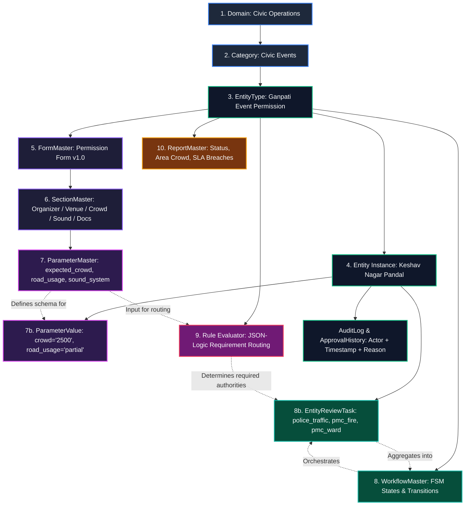

# Phase 1 — Academic Literature to CIVIC-KALKI 10-Level Metadata Hierarchy Mapping

**Author:** Platform / Core Architecture Team  
**Branch:** `feat/civic-metadata-permissions`  
**Theoretical Grounding & Related Work:**
1. **Offenhuber, D. (2019).** *"The Datafication of Civic Infrastructure: Accountability and Citizen Feedback Systems."* IEEE Pervasive Computing, 18(2), 25–33.
   - *Contextual relevance:* Highlights why static relational schemas fail in civic administration—local civic workflows and regulations evolve faster than software release cycles, demanding dynamic metadata-driven schemas.
2. **Janssen, M., Charalabidis, Y., & Zuiderwijk, A. (2022).** *"Automated Workflow Orchestration and Role Delegation in Municipal Service Delivery."* IEEE Transactions on Engineering Management, 69(4), 1435–1448.
   - *Contextual relevance:* Examines workflow orchestration, multi-agency delegation, and finite state machines in public sector service delivery.

> **Note on Architecture:** The specific 10-level metadata hierarchy (`Domain → Category → Entity Type → Entity Instance → Form → Sections → Parameters → Workflow → Rules → Reports`) is CIVIC-KALKI's concrete architectural model, synthesizing metadata registry principles (inspired by ISO/IEC 11179 and dynamic e-governance form engines) into a production relational database. It is not an off-the-shelf IEEE paper specification, but rather the project's own design to prove zero-code civic capability addition.

---

## 1. The 10-Level CIVIC-KALKI Metadata Hierarchy

The project's architectural claim is proven by mapping the target 10-level hierarchy directly into data records, using the canonical permission capability example:

| Hierarchy Level | Architectural Concept | Database Construct | Manifestation in Ganpati Permission Example |
| :--- | :--- | :--- | :--- |
| **1. Domain** | Broad municipal operational boundary | `Domain` (`domain_id`, `domain_name`) | `domain_name = "Civic Operations"` or `"Civic Events"` |
| **2. Category / Sub-Domain** | Logical grouping of related civic activities | `Domain` / `EntityType.domain_id` | `"Civic Events"` category |
| **3. Entity Type** | Reusable capability definition (zero code) | `EntityType` (`entity_type_id`, `domain_id`, `name`) | `name = "Ganpati Event Permission"` |
| **4. Entity Instance** | Specific citizen request or permit application | `Entity` (`entity_id`, `owner_user_id`, `status`) | e.g. `"Keshav Nagar Sarvajanik Pandal 2026"` (status: `"submitted"`) |
| **5. Form** | Versioned data collection specification | `FormMaster` (`form_id`, `form_name`, `version`) | `form_name = "Ganpati Event Permission Application Form"`, `v1.0` |
| **6. Sections & Subsections** | Visual and logical grouping of inputs | `SectionMaster` + `SubsectionMaster` | `Organizer`, `Venue & Schedule`, `Crowd & Road`, `Sound`, `Support`, `Documents` |
| **7. Parameters** | Dynamic field definitions, controls, types, visibility | `ParameterMaster` + `ParameterValue` + `FileRepository` | `expected_crowd` (number), `road_usage` (enum), `pandal_location` (geo), `layout` (file) |
| **8. Workflow** | FSM state machine, legal transitions, aggregation | `WorkflowMaster` + `EntityReviewTask` | `draft → submitted → coordinator_verification → department_review → approved/rejected` |
| **9. Rules** | Zero-eval JSON-Logic requirement & routing rules | `ruleEvaluator.js` + `authorityRoutingEngine.js` | `expected_crowd >= 500 -> require("police_local_station")`, `road_usage != 'none' -> require("police_traffic")` |
| **10. Reports** | Declarative analytics and export definitions | `ReportMaster` (`filters`, `output_format`) | Permissions by status, area crowd density, pending reviews with SLA tracking |

---

## 2. Cardinality, Versioning & Ownership per Level

| Level | Parent | Child | Cardinality | Versioning Strategy | Ownership & Lifecycle |
| :--- | :--- | :--- | :--- | :--- | :--- |
| **1. Domain** | Root | EntityType | 1 : N | Immutable system identifier | Directorate / Admin |
| **2. Category** | Domain | EntityType | 1 : N | Domain classification | Directorate / Admin |
| **3. EntityType** | Domain | FormMaster, WorkflowMaster, Entity | 1 : N | Semantic capability key | Domain Administrator |
| **4. Entity** | EntityType | ParameterValue, ReviewTask, AuditLog | 1 : N | State machine progression (`status`) | Citizen (Applicant) / Reviewers |
| **5. FormMaster** | EntityType | SectionMaster | 1 : N | Semantic versioning (`version = "1.0"`) | Form Designer |
| **6. SectionMaster** | FormMaster | SubsectionMaster | 1 : N | `display_order` sequencing | Form Designer |
| **7. ParameterMaster** | SubsectionMaster| ParameterValue | 1 : N | Unique field key (`field_key`) | Form Designer |
| **8. WorkflowMaster**  | EntityType | EntityReviewTask | 1 : N | Declarative state machine config | Governance Committee |
| **9. Rules** | EntityType | EntityReviewTask (routing) | 1 : N | Versioned JSON-logic AST | Domain Policy Maker |
| **10. ReportMaster**    | EntityType | Generated Analytics | 1 : N | Parametric filter config (`filters`) | Municipal Analytics |

---

## 3. Conceptual Model Diagram (Mermaid)

---

## 4. Key Design Decisions

1. **Fixed 3-Tier Form Hierarchy vs Arbitrary Nesting**:
   - Rather than recursive nested sections of arbitrary depth (which introduce recursive SQL joins and heavy client-side tree rendering), CIVIC-KALKI enforces a clean 3-tier structure (`FormMaster → SectionMaster → SubsectionMaster → ParameterMaster`).
   - This cleanly represents 100% of municipal permit structures while preserving single-query performance (`GET /forms/:id/schema`).
2. **Data-Driven Authority Routing vs Role Proliferation**:
   - Review authorities are records (`authority_key`, `review_scope`), not hardcoded application roles.
   - RBAC roles remain standardized (`citizen`, `coordinator_area`, `coordinator_general`, `director`, `admin`), avoiding the need to create separate database user roles for each municipal department.
3. **Normalized EAV with JSON Metadata**:
   - Parameter values are stored in `ParameterValue` with an indexed `(entity_id, parameter_id)` unique constraint.
   - Flexible attributes (help text, dynamic visibility rules, choices) are stored in `ParameterMaster.options` JSON, giving schema flexibility without sacrificing relational integrity.
