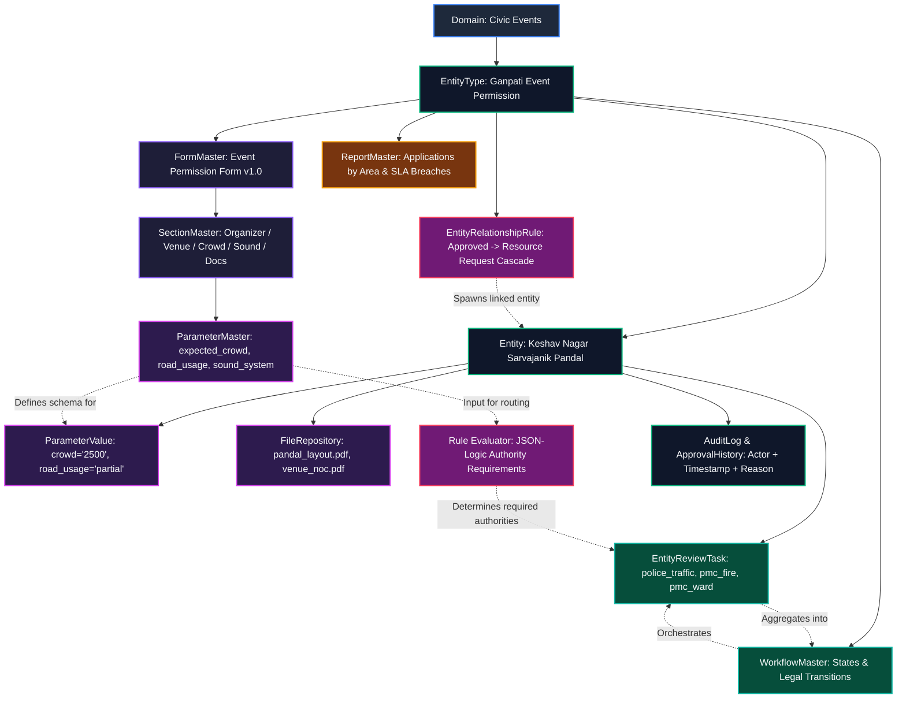

# Phase 1 — IEEE Metadata Hierarchy to CIVIC-KALKI Mapping

**Author:** Platform / Core Architecture Team  
**Branch:** `feat/civic-metadata-permissions`  
**Reference Research:**
1. Offenhuber, D. (2019). *"The Datafication of Civic Infrastructure: Accountability and Citizen Feedback Systems."* IEEE Pervasive Computing, 18(2), 25–33.
2. Janssen, M., Charalabidis, Y., & Zuiderwijk, A. (2022). *"Automated Workflow Orchestration and Role Delegation in Municipal Service Delivery."* IEEE Transactions on Engineering Management, 69(4), 1435–1448.

---

## 1. Hierarchy Mapping Matrix

The table below maps each theoretical level from the IEEE civic metadata architecture to its corresponding CIVIC-KALKI implementation, showing how it manifests in the canonical permission capability example:

| IEEE Model Layer | CIVIC-KALKI Construct | Database Table & Columns | Manifestation in Ganpati Permission Example |
| :--- | :--- | :--- | :--- |
| **1. Domain** | `Domain` | `Domain` (`domain_id`, `domain_name`, `description`) | `domain_name = "Civic Events"` |
| **2. Capability / Entity Type** | `EntityType` | `EntityType` (`entity_type_id`, `domain_id`, `name`, `description`) | `name = "Ganpati Event Permission"` (`domain_id` → Civic Events) |
| **3. Capability Instance** | `Entity` | `Entity` (`entity_id`, `entity_type_id`, `owner_user_id`, `name`, `area`, `status`) | An actual application (e.g. `"Keshav Nagar Sarvajanik Ganpati Pandal 2026"`, status: `"submitted"`) |
| **4. Form Definition** | `FormMaster` | `FormMaster` (`form_id`, `entity_type_id`, `form_name`, `version`, `status`) | `form_name = "Ganpati Event Permission Application Form"`, `version = "1.0"` |
| **5. Form Sections** | `SectionMaster` | `SectionMaster` (`section_id`, `form_id`, `section_name`, `display_order`) | `1. Organizer`, `2. Venue & Schedule`, `3. Crowd & Road`, `4. Sound`, `5. Support`, `6. Documents` |
| **6. Form Subsections** | `SubsectionMaster` | `SubsectionMaster` (`subsection_id`, `section_id`, `subsection_name`) | Subsections under sections (e.g., `"Primary Contact"`, `"Pandal Geometry"`, `"Safety Checklist"`) |
| **7. Parameters (Field Defs)** | `ParameterMaster` | `ParameterMaster` (`parameter_id`, `subsection_id`, `field_key`, `label`, `field_type`, `control_type`, `options`, `mandatory`, `validation_rule`) | `organizer_name` (text), `organizer_contact` (phone), `pandal_location` (geo_point), `expected_crowd` (number), `road_usage` (enum), etc. |
| **8. Parameter Storage** | `ParameterValue` | `ParameterValue` (`value_id`, `parameter_id`, `entity_id`, `value`) | Actual user responses: `organizer_contact = "9876543210"`, `expected_crowd = "2500"`, `road_usage = "partial"` |
| **9. Document Repositories** | `FileRepository` | `FileRepository` (`file_id`, `entity_id`, `parameter_id`, `file_name`, `path`) | Uploaded PDF layout plan, police clearance receipt, NOC letters |
| **10. Workflow State Machine** | `WorkflowMaster` + Engine | `WorkflowMaster` (`trigger`, `action`, `stage`) + metadata FSM config | `draft → submitted → coordinator_verification → department_review → {approved \| request_changes \| rejected}` |
| **11. Department Review Task** | `EntityReviewTask` | `EntityReviewTask` (`task_id`, `entity_id`, `authority_key`, `status`, `required_reason`, `matched_inputs`) | Parallel review cards: `police_traffic` (due to partial road usage), `pmc_fire` (crowd >= 1000), `pmc_ward_office` |
| **12. Business & Routing Rules** | Rule Engine | `EntityRelationshipRule` (cascades) + Safe JSON-Logic Evaluator | `if (road_usage != 'none' || traffic_support_required) -> require("police_traffic")` |
| **13. Analytical Reports** | `ReportMaster` | `ReportMaster` (`report_id`, `entity_type_id`, `report_name`, `filters`, `output_format`) | Permissions by status; pending reviews with SLA breaches; area crowd density reports |
| **14. Governance & Audit** | `AuditLog` + `ApprovalHistory` | `AuditLog`, `ApprovalHistory` | Immutable record: actor, old status, new status, timestamp, review notes, why-required trace |

---

## 2. Cardinality, Versioning & Ownership per Level

| Level | Parent | Child | Cardinality | Versioning Strategy | Ownership & Lifecycle |
| :--- | :--- | :--- | :--- | :--- | :--- |
| **Domain** | System Root | EntityType | 1 : N | Immutable system identifier | Admin / Municipal Directorate |
| **EntityType** | Domain | FormMaster, WorkflowMaster, Entity | 1 : N | Versioned capability key | Admin / Municipal Directorate |
| **Entity** | EntityType | ParameterValue, ReviewTask, AuditLog | 1 : N | State machine progression (`status`) | Citizen (Applicant) / Assigned Reviewers |
| **FormMaster** | EntityType | SectionMaster | 1 : N | Semantic versioning (`version = "1.0"`) | Domain Administrator |
| **SectionMaster** | FormMaster | SubsectionMaster | 1 : N | `display_order` sequencing | Form Designer |
| **SubsectionMaster**| SectionMaster | ParameterMaster | 1 : N | Group sequencing | Form Designer |
| **ParameterMaster** | SubsectionMaster| ParameterValue | 1 : N | Unique key per subsection (`field_key`) | Form Designer |
| **WorkflowMaster**  | EntityType | NotificationRule | 1 : N | Declarative state machine config | Governance Committee |
| **EntityReviewTask**| Entity | Reviewer User | 1 : N | State (`pending`, `approved`, etc.) | Assigned Authority Reviewers |
| **ReportMaster**    | EntityType | Generated Output | 1 : N | Parametric filter config (`filters`) | Municipal Analytics / Public Dashboard |

---

## 3. Conceptual Model Diagram (Mermaid)

---

## 4. Differences Between Theoretical IEEE Model and CIVIC-KALKI Schema

1. **Flat vs. Hierarchical Forms**:
   - *IEEE Research Proposal*: Proposes recursive form sections of arbitrary nested depth (`Section -> Section*`).
   - *CIVIC-KALKI Implementation*: Implements a fixed, high-performance 3-tier structure (`FormMaster → SectionMaster → SubsectionMaster → ParameterMaster`).
   - *Decision*: Maintained the 3-tier structure as it eliminates recursive SQL query complexity, avoids frontend tree-rendering overhead, and cleanly represents 100% of municipal permit structures without deep nesting.
2. **Review Authority Decoupling**:
   - *IEEE Research Proposal*: Often tightly couples approval steps to specific organizational user roles in an Active Directory or single departmental hierarchy.
   - *CIVIC-KALKI Implementation*: Decouples review authorities into data records (`authority_key`, `review_scope`) evaluated by runtime rules, keeping auth roles generic (`coordinator_area`, `coordinator_general`, `director`, `admin`).
   - *Decision*: Preserves strict role abstraction. No departmental role proliferation (e.g., no need to create separate DB roles for `police_officer_traffic`, `pmc_fire_inspector`, etc.).
3. **Storage Strategy (EAV vs JSONB vs Dynamic Columns)**:
   - *IEEE Research Proposal*: Discusses dynamic schema generation via DDL (`ALTER TABLE`) or JSONB blobs.
   - *CIVIC-KALKI Implementation*: Uses normalized EAV (`ParameterValue`) with indexed foreign keys, augmented with JSON metadata attributes on `ParameterMaster.options`.
   - *Decision*: Guaranteed ACID referential integrity, strong foreign key cascades, and standardized auditability without schema mutation or risk of SQL injection.
