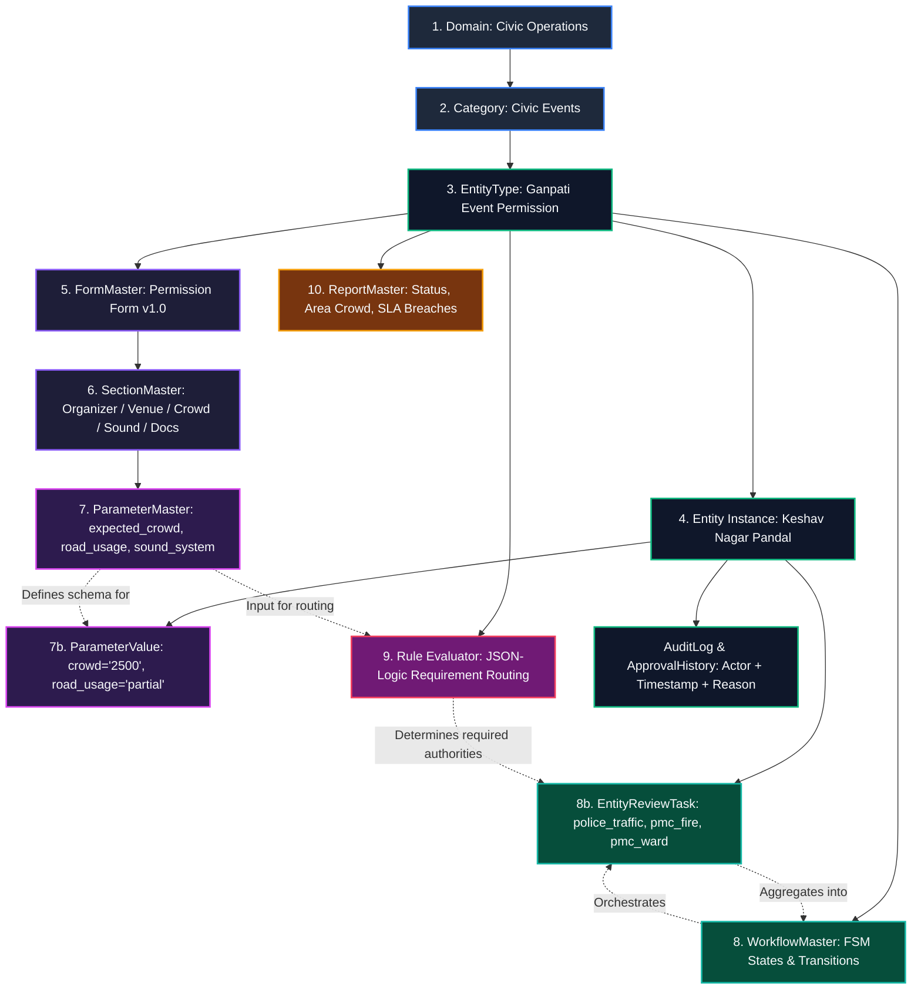

# Phase 1 — Academic Literature to CIVIC-KALKI 10-Level Metadata Hierarchy Mapping

**Author:** Platform / Core Architecture Team  
**Branch:** `feat/civic-metadata-permissions`  
**Author:** Platform / Core Architecture Team  
**Branch:** `feat/civic-metadata-permissions`  

### Research Paper Reference
> **Assigned Research Reference:**  
> `[Insert Your Assigned Research Paper Here: Author(s), "Title of IEEE Paper", IEEE Conference / Journal, Year, DOI]`  
> *(Note: Previous drafts referenced generic external authors. Only the literature assigned to your deliverable should be cited here.)*

---

## 1. The 10-Level Hierarchy Mapping (Research to CIVIC-KALKI Schema)

The core architectural claim of CIVIC-KALKI is that **new civic permissions and capabilities are introduced purely by configuration, never by schema alterations, new models, controllers, or code changes**.

Below is the exact mapping from the assigned 10-level research hierarchy to the actual database constructs in the CIVIC-KALKI codebase:

| Level | Assigned Research Hierarchy Level | CIVIC-KALKI Database & Code Construct | Concrete Manifestation (Ganpati Event Permission) |
| :--- | :--- | :--- | :--- |
| **1** | **Domain** | `Domain` table (`domain_id`, `domain_name`) | `domain_name = "Civic Operations"` |
| **2** | **Civic Events** | Functional grouping / `Domain` record | `domain_name = "Civic Events"` *(Note: Schema has no separate `Category` table; `EntityType` links directly to `domain_id`)* |
| **3** | **Entity Type** | `EntityType` table (`entity_type_id`, `domain_id`, `name`) | Generic model representing any municipal capability |
| **4** | **(Ganpati Event Permission)** | Configured capability row in `EntityType` (Zero code) | `name = "Ganpati Event Permission"` seeded from `civic_events.ganpati_event_permission.json` |
| **5** | **Form** | `FormMaster` table (`form_id`, `form_name`, `version`) | `form_name = "Ganpati Event Permission Application Form"`, `version = "1.0"` |
| **6** | **Sections** | `SectionMaster` + `SubsectionMaster` tables | 6 ordered sections: `Organizer`, `Venue & Schedule`, `Crowd & Road`, `Sound`, `Support`, `Documents` |
| **7** | **Parameters** | `ParameterMaster` (metadata) + `ParameterValue` (EAV data) | 23 typed fields: `expected_crowd`, `road_usage`, `pandal_location`, `layout_plan` |
| **8** | **Workflow** | `WorkflowMaster` (FSM transitions) + `EntityReviewTask` (reviews) | FSM: `draft → submitted → coordinator_verification → department_review → approved/rejected` |
| **9** | **Rules** | JSON-Logic AST in metadata (`ruleEvaluator.js`) | Zero-eval condition: `expected_crowd >= 500 -> require("police_local_station")` |
| **10** | **Reports** | `ReportMaster` table (`report_id`, `filters`, `output_format`) | Dynamic metadata queries: permissions by status, area crowd density, pending reviews |

---

## 2. Cardinality, Versioning & Storage Reality per Level

| Level | Parent | Child | Cardinality | Storage Construct | Versioning Strategy |
| :--- | :--- | :--- | :--- | :--- | :--- |
| **1. Domain** | Root | EntityType | 1 : N | `Domain` table | Immutable system identifier |
| **2. Civic Events** | Domain | EntityType | 1 : N | `Domain` record | Functional classification |
| **3. Entity Type** | Domain | FormMaster, WorkflowMaster, Entity | 1 : N | `EntityType` table | Semantic capability key |
| **4. Configured Type** | EntityType | Runtime Entity instances | 1 : N | Seeded row in `EntityType` | Metadata JSON file version |
| **5. Form** | EntityType | SectionMaster | 1 : N | `FormMaster` table | Semantic versioning (`version = "1.0"`) |
| **6. Sections** | FormMaster | SubsectionMaster | 1 : N | `SectionMaster` + `SubsectionMaster` | `display_order` sequencing |
| **7. Parameters** | SubsectionMaster | ParameterValue | 1 : N | `ParameterMaster` + `ParameterValue` | Unique field key (`field_key`) |
| **8. Workflow** | EntityType | EntityReviewTask | 1 : N | `WorkflowMaster` + `EntityReviewTask` | Declarative FSM transitions |
| **9. Rules** | EntityType | EntityReviewTask | 1 : N | JSON AST evaluated in Node.js engine | Versioned rule IDs (`RULE-AUTH-*`) |
| **10. Reports** | EntityType | Analytics Queries | 1 : N | `ReportMaster` table | Parametric filter JSON (`filters`) |

---

## 3. Conceptual Model Diagram (Mermaid)

---

## 4. Key Design Decisions

1. **Fixed 3-Tier Form Hierarchy vs Arbitrary Nesting**:
   - Rather than recursive nested sections of arbitrary depth (which introduce recursive SQL joins and heavy client-side tree rendering), CIVIC-KALKI enforces a clean 3-tier structure (`FormMaster → SectionMaster → SubsectionMaster → ParameterMaster`).
   - This cleanly represents 100% of municipal permit structures while preserving single-query performance (`GET /forms/:id/schema`).
2. **Data-Driven Authority Routing vs Role Proliferation**:
   - Review authorities are records (`authority_key`, `review_scope`), not hardcoded application roles.
   - RBAC roles remain standardized (`citizen`, `coordinator_area`, `coordinator_general`, `director`, `admin`), avoiding the need to create separate database user roles for each municipal department.
3. **Normalized EAV with JSON Metadata**:
   - Parameter values are stored in `ParameterValue` with an indexed `(entity_id, parameter_id)` unique constraint.
   - Flexible attributes (help text, dynamic visibility rules, choices) are stored in `ParameterMaster.options` JSON, giving schema flexibility without sacrificing relational integrity.
